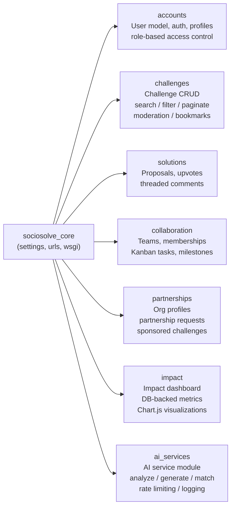
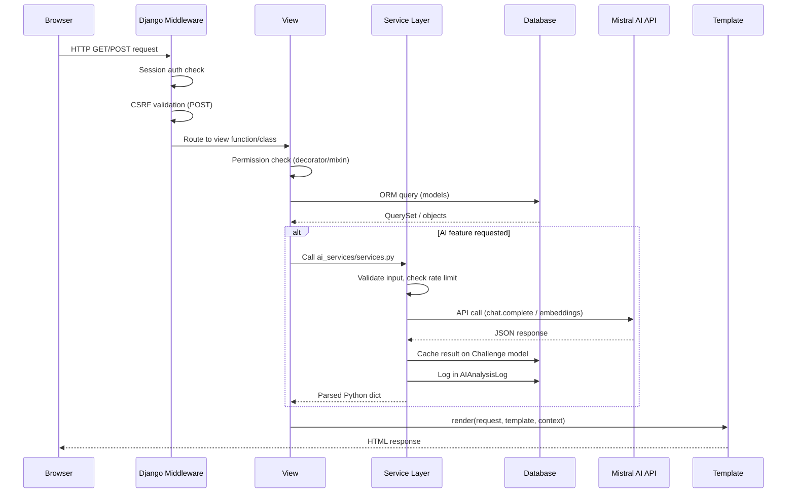

# SocioSolve — Project Architecture

## Overview

SocioSolve follows a classic **Django MTV (Model-Template-View)** architecture with a clear separation of concerns across seven Django applications. All business logic lives in the server; the browser only renders pre-built HTML.

---

## Application Architecture Diagram

```mermaid
flowchart TD
    Browser["Browser / Client\n(HTML + Bootstrap 5 + JS)"]
    Django["Django 5.1 Application Server"]
    SQLite["SQLite (Development)\ndb.sqlite3"]
    PG["PostgreSQL (Production)\n+ pgvector extension"]
    Mistral["Mistral AI API\nchat.complete + embeddings"]
    Media["Media Files\n/media/ directory"]

    Browser -->|HTTP Request| Django
    Django -->|HTTP Response (HTML)| Browser
    Django -->|ORM Queries| SQLite
    Django -->|ORM Queries| PG
    Django -->|HTTPS API Call| Mistral
    Django -->|File I/O| Media
```

---

## Django Application Map



---

## Directory Structure

```
SocioSolver/
│
├── sociosolve_core/              # Project configuration package
│   ├── __init__.py
│   ├── settings.py               # All settings, dotenv-loaded
│   ├── urls.py                   # Root URL dispatcher
│   ├── wsgi.py
│   └── asgi.py
│
├── accounts/                     # AUTH app
│   ├── models.py                 # Custom User (AbstractUser extension)
│   ├── forms.py                  # Registration, profile, login forms
│   ├── views.py                  # register, login, logout, profile, dashboard
│   ├── decorators.py             # role_required(), admin_only()
│   ├── context_processors.py     # Injects UserRole enum to all templates
│   ├── admin.py
│   ├── urls.py
│   ├── tests.py                  # 5 auth tests
│   └── management/
│       └── commands/
│           └── load_demo_data.py # Demo fixture command
│
├── challenges/                   # CHALLENGE app
│   ├── models.py                 # Challenge, ChallengeCategory, Report, Bookmark
│   ├── forms.py                  # ChallengeForm, ChallengeReportForm
│   ├── views.py                  # list, detail, create, update, delete, bookmark, report
│   ├── error_views.py            # Custom 400/403/404/500 handlers
│   ├── admin.py
│   ├── urls.py
│   └── tests.py                  # 5 challenge tests
│
├── solutions/                    # SOLUTIONS app
│   ├── models.py                 # SolutionProposal, SolutionVote, DiscussionComment
│   ├── forms.py
│   ├── views.py                  # proposal CRUD, vote toggle, comment CRUD
│   ├── admin.py
│   ├── urls.py
│   └── tests.py                  # 3 solution tests
│
├── collaboration/                # COLLABORATION app
│   ├── models.py                 # ProjectTeam, TeamMembership, ProjectTask, ProjectMilestone
│   ├── forms.py
│   ├── views.py                  # team create/detail, join/approve, tasks, milestones
│   ├── admin.py
│   ├── urls.py
│   └── tests.py                  # 5 collaboration tests
│
├── partnerships/                 # PARTNERSHIPS app
│   ├── models.py                 # OrganizationProfile, PartnershipRequest, SponsoredChallenge
│   ├── forms.py
│   ├── views.py                  # org CRUD, partnership/sponsorship management
│   ├── admin.py
│   └── urls.py
│
├── impact/                       # IMPACT app
│   ├── models.py                 # ImpactReport (is_verified field)
│   ├── forms.py
│   ├── views.py                  # dashboard (live DB queries), report CRUD
│   ├── admin.py
│   ├── urls.py
│   └── tests.py                  # 2 impact tests
│
├── ai_services/                  # AI INTEGRATION app
│   ├── models.py                 # AIAnalysisLog
│   ├── services.py               # All AI logic (no direct API calls in views)
│   ├── views.py                  # HTTP endpoints wrapping services
│   ├── admin.py
│   ├── urls.py
│   └── tests.py                  # 7 AI tests (fully mocked)
│
├── templates/                    # All HTML templates
│   ├── base.html                 # Master layout (Bootstrap 5.3 CDN, Chart.js, custom CSS/JS)
│   ├── navbar.html               # Responsive navigation
│   ├── footer.html
│   ├── landing.html              # Public homepage
│   ├── accounts/
│   ├── challenges/
│   ├── solutions/
│   ├── collaboration/
│   ├── partnerships/
│   ├── impact/
│   ├── ai_services/
│   └── errors/                   # 400, 403, 404, 500 pages
│
├── static/
│   ├── css/style.css             # Custom styles, CSS variables
│   └── js/main.js                # AJAX upvoting, tooltips, demo autofill
│
├── media/                        # User uploads (gitignored in production)
├── docs/                         # Documentation
├── db.sqlite3                    # SQLite database (development)
├── manage.py
├── requirements.txt
├── .env                          # Secrets (never committed)
├── .env.example                  # Template for .env
├── .gitignore
└── README.md
```

---

## Request Lifecycle



---

## URL Structure

| Prefix | App | Description |
|--------|-----|-------------|
| `/` | challenges | Landing page (public) |
| `/accounts/` | accounts | Auth: register, login, logout, profile, dashboard |
| `/challenges/` | challenges | Challenge list, detail, create, edit, delete |
| `/solutions/` | solutions | Proposals, votes, comments |
| `/collaboration/` | collaboration | Teams, tasks, milestones |
| `/partnerships/` | partnerships | Org profiles, partnerships, sponsorships |
| `/impact/` | impact | Dashboard, impact reports |
| `/ai/` | ai_services | AI analyze, generate, similar, team-match |
| `/admin/` | Django admin | Superuser admin panel |

---

## Key Architecture Decisions

### 1. Custom User Model Before First Migration
`accounts.User` extends `AbstractUser` and is set as `AUTH_USER_MODEL` in `settings.py` before any migrations were run. This is the correct Django pattern — changing the user model after migrations would require a complex data migration.

### 2. AI Service Module Pattern
All Mistral API calls live in `ai_services/services.py`. Views call service methods, not the Mistral SDK directly. This:
- Keeps views thin and testable
- Enables easy mocking in tests
- Centralizes error handling, rate limiting, and logging

### 3. AI Results Cached on Challenge Model
`Challenge.ai_analysis_cache` and `Challenge.ai_solutions_cache` are JSONFields. Once a challenge is analyzed, the result is stored and served from the database on subsequent requests — no repeated API calls.

### 4. Graceful AI Degradation
If `MISTRAL_API_KEY` is not set:
- `ai_services/services.py` raises `AIServiceUnavailableError`
- Views catch this and show a user-friendly error message
- Similar challenge finder falls back to keyword text search
- No fake results are ever shown

### 5. Server-Side Permissions
All permission checks are in views (decorators and `request.user` checks). Template conditionals like `` are cosmetic-only. The actual enforcement is in the view.

### 6. Database-Backed Statistics
The impact dashboard builds every metric with Django ORM aggregations (`.count()`, `.aggregate()`, `.annotate()`). There are zero hardcoded numbers.

---

## Production Deployment Checklist

```python
# settings.py production changes:
DEBUG = False
ALLOWED_HOSTS = ['yourdomain.com']
SECRET_KEY = os.environ['SECRET_KEY']  # from environment, not .env file

# Database — PostgreSQL
DATABASES = {
    'default': dj_database_url.parse(os.environ['DATABASE_URL'])
}

# Static files — serve via Whitenoise or CDN
STATICFILES_STORAGE = 'whitenoise.storage.CompressedManifestStaticFilesStorage'

# Media files — use S3 or equivalent
DEFAULT_FILE_STORAGE = 'storages.backends.s3boto3.S3Boto3Storage'

# Email — configure SMTP backend
EMAIL_BACKEND = 'django.core.mail.backends.smtp.EmailBackend'

# HTTPS
SECURE_SSL_REDIRECT = True
SESSION_COOKIE_SECURE = True
CSRF_COOKIE_SECURE = True
SECURE_HSTS_SECONDS = 31536000
```

**Production commands:**
```bash
python manage.py collectstatic --no-input
python manage.py migrate
gunicorn sociosolve_core.wsgi:application --bind 0.0.0.0:8000
```
