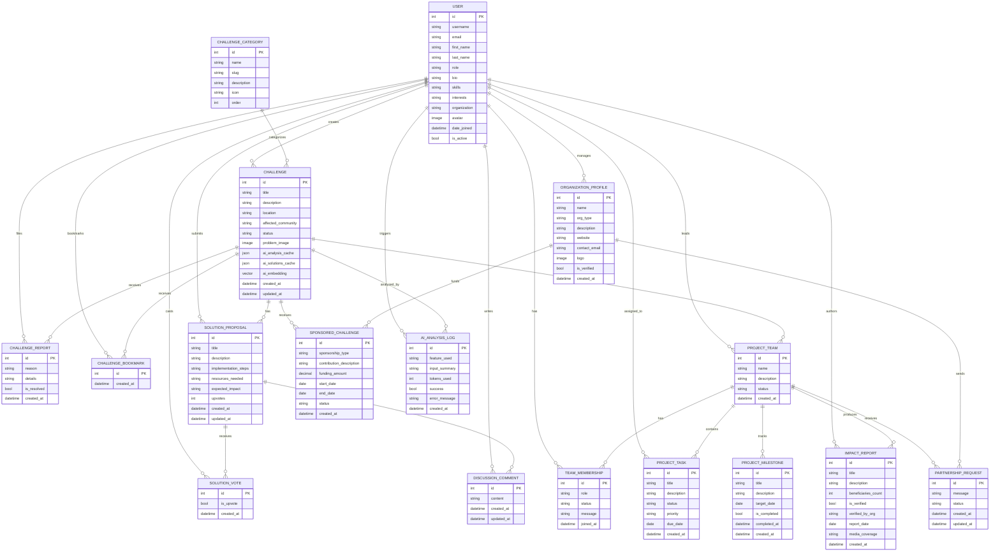

# SocioSolve — Entity-Relationship Diagram

This document shows all database models and their relationships using a Mermaid ER diagram.

---

## Full ER Diagram

---

## Key Design Decisions

### Custom User Model
Django's `AbstractUser` is extended with `role`, `bio`, `skills`, `interests`, `organization`, and `avatar` fields. Using a custom user model from the start avoids painful migrations later.

### One Vote Per User Per Proposal
`SolutionVote` has a `unique_together = ('proposal', 'user')` constraint enforced at the database level — not just in application code. This prevents duplicate votes even if application logic is bypassed.

### AI Cache Fields on Challenge
`ai_analysis_cache` (JSONField) and `ai_solutions_cache` (JSONField) store AI responses directly on the Challenge model. This avoids re-calling the API on every page load. The `ai_embedding` field stores a comma-separated vector for semantic similarity search.

### Verified vs Self-Reported Impact
`ImpactReport.is_verified` distinguishes independently verified impact data from self-reported estimates. The UI clearly badges each report accordingly. No numbers are presented as verified facts unless explicitly marked.

### AI Analysis Log
Every AI API call is logged in `AIAnalysisLog` with the feature used, token count, success status, and error message. This enables monitoring, debugging, and cost estimation.

### Cascade Deletes
Challenge deletion cascades to all related proposals, votes, comments, team links, bookmarks, and reports. User deletion sets the `creator` field to `NULL` on challenges (via `SET_NULL`) to preserve the challenge record.

---

## Model Relationships Summary

| From | To | Relationship |
|------|----|--------------|
| User | Challenge | One-to-many (creator) |
| User | SolutionProposal | One-to-many (author) |
| User | SolutionVote | One-to-many (unique per proposal) |
| User | ProjectTeam | One-to-many (leader) |
| User | TeamMembership | One-to-many (member) |
| Challenge | ChallengeCategory | Many-to-one |
| Challenge | SolutionProposal | One-to-many |
| Challenge | ProjectTeam | One-to-many |
| ProjectTeam | ProjectTask | One-to-many |
| ProjectTeam | ProjectMilestone | One-to-many |
| ProjectTeam | ImpactReport | One-to-many |
| OrganizationProfile | PartnershipRequest | One-to-many |
| OrganizationProfile | SponsoredChallenge | One-to-many |
